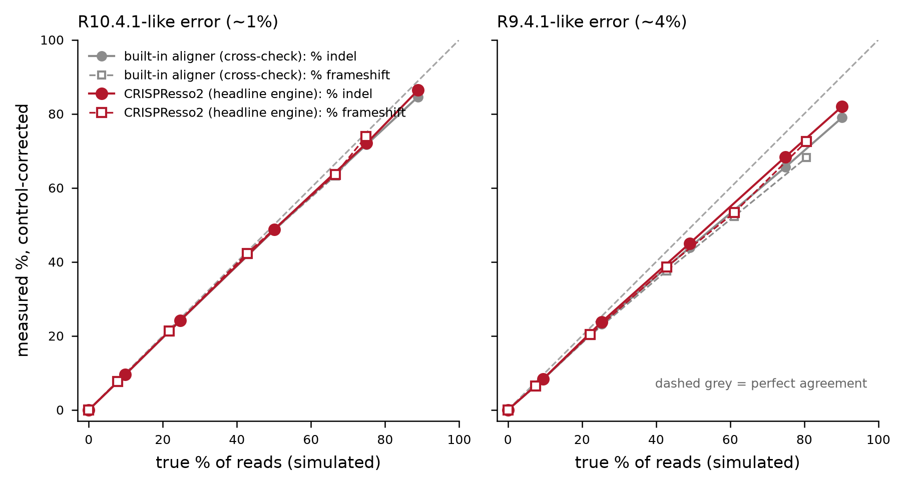

# Method

## 1. What is being measured

For a CRISPR nuclease (SpCas9) experiment, "editing efficiency" at an amplicon
is the fraction of sequenced molecules that carry an insertion or deletion
attributable to repair of the Cas9 double-strand break:

```
% modified = reads with an indel overlapping the cut-site window / informative reads x 100
```

Two refinements matter for a knockout experiment:

* **% frameshift** — the fraction of reads whose net indel length inside the
  coding sequence is not a multiple of 3. This is the read-level proxy for
  loss-of-function alleles. In-frame indels at a cut site may or may not
  disrupt protein function and are reported separately.
* **control correction** — the fraction of *unedited* molecules that are
  miscalled as edited is not zero, especially for nanopore reads. An unedited
  control sample measures it directly.

## 2. Pipeline

```
FASTQ
 └── platform detection (read length) ────────────┐
 ├── [ONT] primer-anchored extraction + orienting │  crispr_indel/prep.py
 ├── [Illumina] pre-flight + fastp mate merging   │  crispr_indel/preflight.py
 ├── global alignment to the amplicon             │  CRISPResso2  +  crispr_indel/quick.py
 ├── indel extraction, repeat normalisation       │  crispr_indel/indels.py
 ├── window / frameshift classification           │  crispr_indel/indels.py
 └── control correction, CI, report               │  crispr_indel/report.py
```

### 2.1 Locus definition and cut site

The amplicon, primers, guide and coding sequence live in a YAML file
(`config/PROCR_g1.yaml`). At load time the guide is required to match the
amplicon exactly once on one strand; the PAM is read off the adjacent 3 nt; the
SpCas9 blunt cut is placed 3 nt 5' of the PAM
(`--quantification_window_center -3`, the CRISPResso2 convention). A guide that
matches twice, or not at all, is an error rather than a silent mis-placed
window. `tools/build_amplicon.py` derives all of this for a new locus from a
gene symbol + primer pair + guide by in-silico PCR against Ensembl GRCh38.

### 2.2 Long-read (ONT/PacBio) preprocessing

Nanopore amplicon reads carry barcode and adapter flanks of variable length,
arrive in both orientations, and include truncated molecules and head-to-tail
chimeras. Feeding them to an aligner unprocessed makes truncated reads look
like unmodified reference.

For each read, both primers are located by semi-global alignment (parasail,
match 2 / mismatch −3, gap 5+2k, requiring ≥70% of the maximum primer score),
the read is oriented to the amplicon + strand, and only the primer-to-primer
product is kept. Reads are binned as `ok`, `one_primer` (truncated/failed),
`no_primer` (off-target, dimer, junk), `too_long` (chimera/concatemer, product
> amplicon + 150 bp) or `low_quality` (mean Phred of the product < `--min-q`,
default 10). Only `ok` reads are quantified, and the bin counts are reported —
they are a useful library-QC readout in their own right.

On simulated nanopore data this keeps >98% of intact molecules and removes
~100% of junk/truncated/chimeric reads.

### 2.3 Short-read (Illumina) pre-flight

A read can only report on the cut site if it physically covers it. Before
running anything, the tool measures read lengths and primer orientation on the
first 5,000 reads and checks that reads from the forward primer extend at least
`cut + window + flank` nt (or `L − cut + window + flank` from the reverse
primer), or that mates overlap (`R1 + R2 ≥ amplicon + 10`) so they can be
merged. If neither holds the run stops with an explicit message rather than
reporting a number computed from reads that never saw the cut.

For the PROCR amplicon (428 bp, cut 232 bp from the F primer) this means
2×250 is required; 2×150 cannot work.

### 2.4 Alignment

**CRISPResso2** (Clement et al., *Nat Biotechnol* 2019) is the reference engine
and provides the headline numbers. It performs a Needleman–Wunsch global
alignment of each read to the amplicon with a gap-incentive at the cut site.
Settings used here:

| option | value | reason |
|---|---|---|
| `--quantification_window_center` | −3 | SpCas9 blunt cut |
| `--quantification_window_size` | 1 (`-w`) | CRISPResso2 default |
| `--ignore_substitutions` | on | nuclease KO assay; substitutions are dominated by PCR/sequencing error (see §4) |
| `--exclude_bp_from_left/right` | 20 | primer-derived sequence cannot report variation |
| `--needleman_wunsch_gap_open` | −20 (Illumina) / −10 (ONT) | see below |
| `--coding_seq` | exon-3 CDS | frameshift calls |
| `--min_average_read_quality` | 0 | ONT Q values are not comparable to Illumina; quality filtering happens in prep |

*Gap penalties for nanopore reads.* With the Illumina-strength penalty
(open −20), a nanopore sequencing indel a few bp from a real Cas9 indel is often
cheaper to explain as a run of mismatches than as two gaps, so the real edit
disappears. Lowering the gap-open penalty to −10 recovered 2–3 percentage points
at 50–90% editing in the R9-like regime and changed the R10-like regime by
<0.5 points (`docs/validation.tsv`).

**Built-in engine** (`crispr_indel/quick.py`) is an independent implementation:
parasail semi-global affine alignment (read aligned end-to-end, amplicon ends
free), with separate scoring presets for Illumina (5/−4, gap 20+2k) and ONT
(2/−4, gap 6+2k). It runs on every sample as a cross-check — a disagreement of
more than 2 percentage points raises a warning — and serves as a fallback when
CRISPResso2 is not installed. It processes ~3,000 nanopore reads/s.

### 2.5 Indel extraction and repeat normalisation

Both engines feed their alignments into the same classifier
(`crispr_indel/indels.py`), so the two numbers are comparable by construction.

* Terminal gaps are *not* indels: a leading/trailing gap means the read does
  not cover that part of the amplicon. The covered span is recorded, and a read
  that does not span the window ± `--flank` (default 15 bp) is counted as
  *not informative* rather than as unmodified. This is the single most
  important difference from running CRISPResso2 directly on raw ONT reads.
* An indel is in the window if **any equivalent placement** of it overlaps the
  window. A 1-nt deletion inside a homopolymer can be written at several
  positions; the classifier shifts each indel to its leftmost and rightmost
  equivalent positions and tests the whole range. This makes the call
  independent of where an aligner happens to place a gap, which matters here:
  the PROCR cut site sits between two TTT runs (`CCTTTG|TGAGTTT`).

### 2.6 Classification

For each read with ≥1 in-window indel, the net length change of the indels that
fall inside the coding sequence determines the category:

| category | definition |
|---|---|
| `frameshift` | net coding indel length not divisible by 3 |
| `in-frame` | net coding indel length divisible by 3 (and non-zero events present) |
| `exon-boundary` | a deletion crosses the coding/non-coding boundary (splicing consequence not predictable from the amplicon) |
| `noncoding` | in-window indel entirely outside the coding sequence |
| `substitution` | only with `--count-substitutions` |

### 2.7 Control correction and uncertainty

With an unedited control, the reported efficiency is

```
% modified (corrected) = (T − C) / (100 − C) × 100
```

where T and C are the raw percentages in the treated and control samples. The
correction treats C as the probability that an unedited molecule is *called*
edited, so it removes nanopore background exactly rather than approximately.
The same logic applied to the frameshift fraction gives
`T_fs − (1 − E) × C_fs`, where E is the corrected editing fraction.

A Wilson 95% confidence interval on the raw proportion is reported for each
sample. It reflects read sampling only — not PCR jackpotting, not allele
dropout, not between-replicate variability.

## 3. Validation

`tools/validate.py` simulates reads from the PROCR amplicon with a realistic
SpCas9 outcome spectrum (+1 templated insertion dominant, −1, short and
microhomology-mediated deletions, 50–90 bp deletions, complex indels) and a
nanopore error model with homopolymer-length errors, truncation and chimeras,
then runs the whole CLI and compares with per-read truth.



| true % | R10-like measured | R9-like measured |
|---|---|---|
| 0 | 0.00 | 0.00 |
| 9.8 / 9.5 | 9.50 | 8.37 |
| 24.7 / 25.3 | 24.18 | 23.72 |
| 50.0 / 49.1 | 48.73 | 45.01 |
| 75.0 / 74.9 | 72.07 | 68.35 |
| 88.9 / 90.2 | 86.39 | 81.99 |

(CRISPResso2 engine, control-corrected, 5,000 reads/sample; full table in
`docs/validation.tsv`.)

Behaviour: unbiased at ≤25% editing; a systematic **under-estimate at high
editing** of ~3% relative (R10) and ~9% relative (R9), because a sequencing
error at the cut site can mask a real indel and the control cannot correct for
that. Use R10.4.1 chemistry with SUP/HAC basecalling, and treat high-efficiency
values as lower bounds.

Paired-end Illumina 2×250 on the same simulator: 51.35% measured vs 51.38% true.

## 4. Choices a reviewer may ask about

**Why ignore substitutions by default?** For a nuclease knockout the
informative events are indels. Nanopore substitution error at any given base is
~0.2–1%, which would add several points of background. Setting
`--count-substitutions` recovers some reads where an error masks an indel
(+0.5 points R10, +1.3 points R9 in testing) at the cost of a higher, less
stable background; it also counts genuine SNPs as edits.

**Why a ±1 bp window by default?** It is the CRISPResso2 default and the most
widely reported definition, so values are comparable with the literature.
`all_metrics.tsv` additionally reports ±5, ±10 and whole-amplicon windows from
the same run, which is a useful robustness check: a large gap between the ±1 and
whole-amplicon numbers in the *control* indicates background indels away from
the cut.

**Why not call "knockout %" directly?** An amplicon assay measures alleles, not
cells or protein. % frameshift is the best available proxy; biallelic
disruption in a polyclonal pool is not identifiable from amplicon reads alone,
and in-frame indels can still destroy function.

## 5. Known limitations

* Alleles with a deletion that removes a primer binding site are not amplified
  and are invisible — true efficiency can be higher than measured.
* Large CRISPR-induced rearrangements (kb-scale deletions, inversions,
  translocations, vector integration) are invisible to any short amplicon.
* PCR amplification bias can favour the shorter (deleted) allele; use a
  moderate cycle number and the same conditions for all samples.
* The assay cannot distinguish a homozygous edited diploid from a 100% edited
  pool of heterozygotes.

## 6. References

* Clement K. et al. CRISPResso2: accurate quantification of genome editing.
  *Nat Biotechnol* 37, 224–226 (2019).
* Pinello L. et al. Analyzing CRISPR genome-editing experiments with
  CRISPResso. *Nat Biotechnol* 34, 695–697 (2016).
* McFarlane G.R. et al. CRISPR-Cas guide RNA indel analysis using CRISPResso2
  with Nanopore sequencing data. *BMC Res Notes* 17, 212 (2024).
* Chen S. et al. fastp: an ultra-fast all-in-one FASTQ preprocessor.
  *Bioinformatics* 34, i884–i890 (2018).
* Daily J. Parasail: SIMD C library for global, semi-global, and local pairwise
  sequence alignments. *BMC Bioinformatics* 17, 81 (2016).
